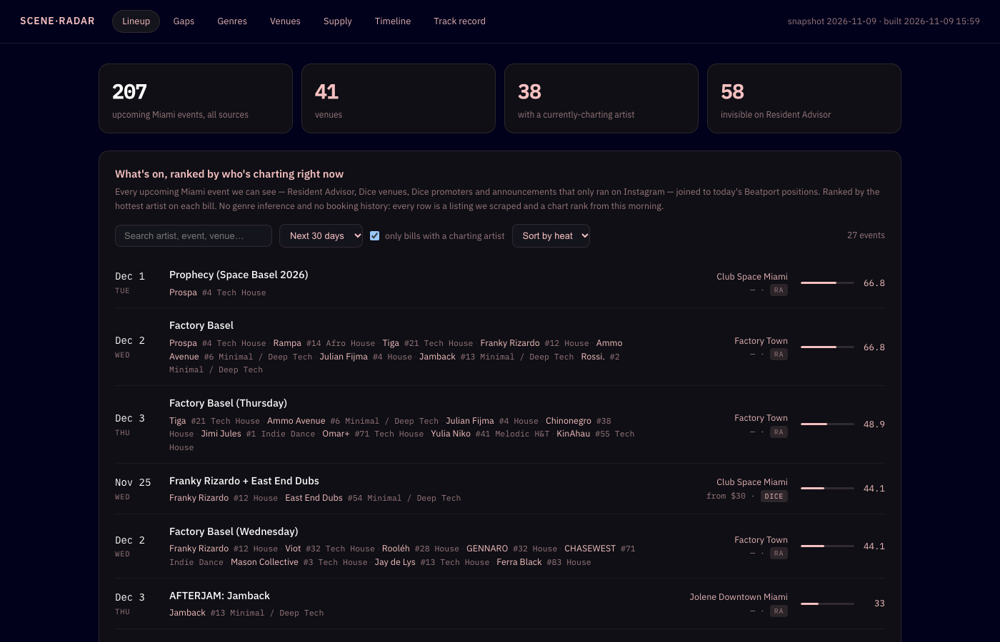

# 📡 Scene Radar — Miami

**Live: [radar.xtremedigits.com](https://radar.xtremedigits.com)** · rebuilt daily by
[GitHub Actions](.github/workflows/daily-radar.yml)

Competitive-intelligence dashboard for electronic music: what's trending on
Beatport (demand) vs. who's actually booked in Miami (supply, from Resident
Advisor **plus** the Dice-only rooms — Club Space, Sable, M2 — plus manual
adds from venue Instagram announcements).
**Gap = artists blowing up with no local dates.** The Timeline tab keeps
receipts: when the radar flagged an artist vs. when a Miami booking appeared.



```
Beatport Top 100 (7 charts) ─┐
RA Miami (GraphQL)           ├─ DuckDB snapshots ─ demand scores ─ fuzzy join ─ gaps
Dice venue pages             │        │
manual_events.json/Supabase ─┘        └─ static dashboard → GitHub Pages (daily cron)
```

## Results so far

As of **Nov 9, 2026**, after **106 days** of daily snapshots (numbers come
from the live dashboard's Timeline tab and update every run):

| | |
|---|---|
| Artists tracked | **996** across 7 Beatport genre charts |
| Bookings flagged early | **45**. The radar flagged them before any Miami date existed |
| Median lead time | **58 days** between being flagged and a Miami booking appearing |
| 30-day conversion | **14.3%** of "hot gap" artists (demand ≥ 40, no Miami bookings) got booked within 30 days |
| Leads thrown out | **57**. They looked like early calls but were data artifacts, explained below |

The 45 is after discarding anything that only *looks* like foresight: a
venue newly added to the dataset (its whole calendar arrives at once), the
first day of tracking, and any lead under 7 days, which mostly measures how
fast an existing announcement gets picked up. An earlier version counted
every positive lead and overstated the result, so the filter is strict on
purpose.

## Setup (5 steps)

1. Install [uv](https://docs.astral.sh/uv/) if you don't have it:
   `curl -LsSf https://astral.sh/uv/install.sh | sh`
2. (Optional) `cp .env.example .env` and set `APIFY_TOKEN` — without it the RA
   collector uses RA's public GraphQL endpoint directly, which works fine.
3. Collect + score + build: `uv run python run_all.py`
4. Open **`dashboard.html`** in your browser. That's it — no server.
5. Tests: `uv run pytest`

Re-running `run_all.py` on the same day reuses the on-disk cache and replaces
that day's snapshot (never duplicates). The GitHub Actions workflow runs the
whole pipeline daily at 9:05 AM Miami time, commits the DuckDB snapshot, and
deploys the dashboard to Pages; momentum scoring diffs against the previous
snapshot.

**Adding events manually** (e.g. a venue announced its season on Instagram):

```bash
uv run python add_events.py screenshot.png     # Claude vision parses the lineup
```

or pass structured JSON with `--json`. Events land in `manual_events.json`
(and Supabase if configured — see `.env.example`), get merged into supply
with a MANUAL badge, and are auto-deduped once the event shows up on RA/Dice.

## What's inside

| Path | What |
|---|---|
| `collect_beatport.py` | Top 100 for 7 genres → `beatport_chart_entries` |
| `collect_ra.py` | RA Miami events next 90d → `ra_events`, `ra_event_artists` |
| `collect_dice.py` | Dice venue pages (Club Space / Sable / M2) → same tables, `source='dice'` |
| `compute_scores.py` | Demand scores + gap table (`artist_scores`, `gaps`) |
| `build_dashboard.py` | Renders `dashboard.html` (self-contained, dark, zero deps) |
| `run_all.py` | All of the above in order |
| `scene_radar/` | The actual logic (config, db, collectors, scoring, matching, template) |
| `data/` | `scene_radar.duckdb` + raw response cache per day (gitignored) |
| `tests/` | Parsing tests against saved real fixtures — break = source changed |

Dashboard views: **Gaps** (the product — filterable artist gap table, hover a
row for the tracks behind the score), **Genres** (demand share vs supply
share), **Venues** (who books what), **Supply** (raw event feed with
RA/DICE/MANUAL badges), **Timeline** (entered radar vs booked, with lead
days), **Track record** (calls logged before their outcomes).

## Building a track record

Two independent kinds of evidence, deliberately kept separate:

**Timeline** is mechanical and unbiased — every tracked artist, no
cherry-picking. It answers "across every artist on the radar (~1,000), how many
got booked, and how far ahead did we see it?" No survivorship bias, because
nothing is hand-selected.

**Track record** is the calls you make explicitly, before the outcome:

```bash
uv run python log_call.py "Vlace" "Gets a Miami booking announced" \
    --why "72 demand, 6 hard techno tracks, no Miami show on record"
uv run python log_call.py --list                       # ledger + hit rate
uv run python log_call.py --resolve call-003 hit --note "Melodic night launched at X"
```

Each call freezes the metrics as they stood that day (demand, bookings,
best chart rank, last played) into `calls.json`, which is committed to git —
so every entry carries a GitHub commit timestamp that can't be back-dated.
Artist calls resolve themselves when a Miami booking appears; genre and
venue calls resolve by hand.

Three rules keep the number meaningful: a call on an artist who **already**
has a booking is refused outright (nothing left to predict), a booking on or
before the call date never counts as a hit, and calls that expire unresolved
are recorded as **misses** rather than quietly dropped. `tests/test_calls.py`
locks all of that in.

## How scoring works (tune in `scene_radar/config.py`)

```
chart_points = Σ (101 - rank) / 10            # height on the charts
raw = 10·charting_tracks + chart_points
    + 0.5·max(rank_velocity, 0)               # climbing vs previous snapshot
    + 8·new_entries                            # fresh entries weighted higher
demand_score = 100 · raw / max(raw)            # leader = 100
gap_score = demand_score / (1 + miami_bookings_90d)
```

First run has no previous snapshot → velocity/new-entries are 0, score is
purely rank-based (per spec). Artist names are normalized (lowercase,
diacritics stripped, `(BR)`/`(DJ set)` suffixes dropped) and joined
exact-first, then rapidfuzz `token_sort_ratio ≥ 90` **plus a per-token guard**
— without the guard, "chris lake" fuzzy-matches "chris clarke" at 90.9 and a
real booking gets credited to the wrong artist. Matches are stored in
`artist_matches` (queryable in DuckDB).

## Implementation notes / deviations from spec

- **`curl-cffi` instead of `httpx`**: both sites reject requests that don't look
  like a normal browser, so the collectors use curl-cffi's browser-compatible
  client. Collection is deliberately light: public pages only, 1 request per
  second, raw responses cached to disk, and one pass a day.
- **Beatport needs no HTML parsing**: charts ship as embedded `__NEXT_DATA__`
  JSON. Parser validates hard and raises rather than writing partial data.
- **RA via GraphQL is the primary tested path** (`ra.co/graphql`, Miami area
  id 38). The Apify actor path exists (`APIFY_TOKEN` + optional
  `RA_APIFY_ACTOR` in `.env`) and falls back to GraphQL on any failure.
- **Dice was pulled forward from Phase 3** because Club Space Miami and Sable
  Miami list **zero** events on RA (verified against their RA venue pages,
  clubs 831/273769) — they ticket on Dice. The collector fetches just the
  three configured venue pages (`DICE_VENUES` in config). Dice event titles
  are the lineup ("Oliver Koletzki + Manumat"), so artists are parsed from
  titles; Dice cards carry no genre tags, so their genre is inferred from
  matched lineup artists' Beatport chart buckets in the supply-share view.
- **Dashboard is generated static HTML** (`scene_radar/dashboard_template.html`
  + embedded JSON). Streamlit was dropped by request.

## Roadmap (per spec)

- **Phase 2:** 1001Tracklists set-play counts, SoundCloud velocity, weighted
  blend into `demand_score`.
- **Phase 3 (remaining):** more Dice venues or full Dice-Miami browse,
  Ticketmaster for the bigger rooms, trend lines over weeks, threshold
  alerts, cross-source event dedupe.
